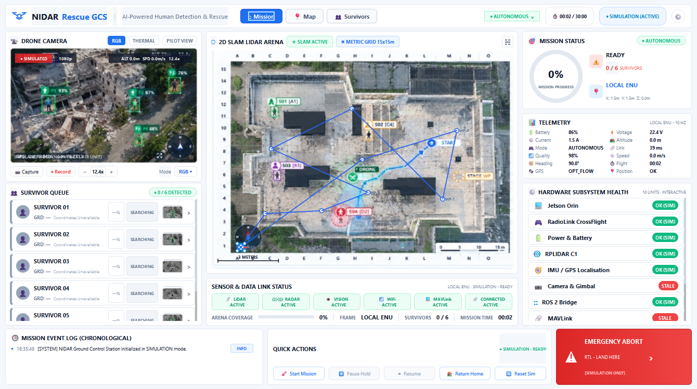
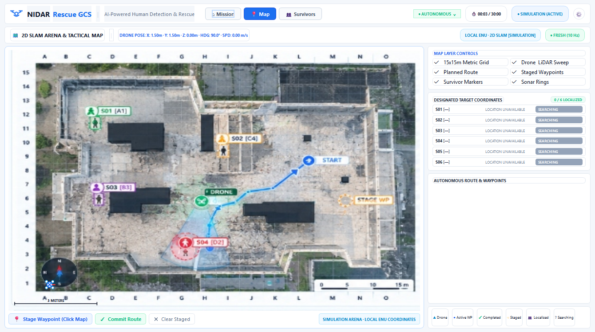
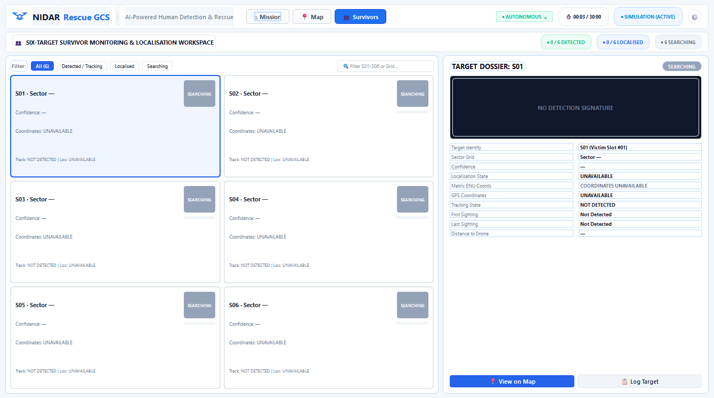
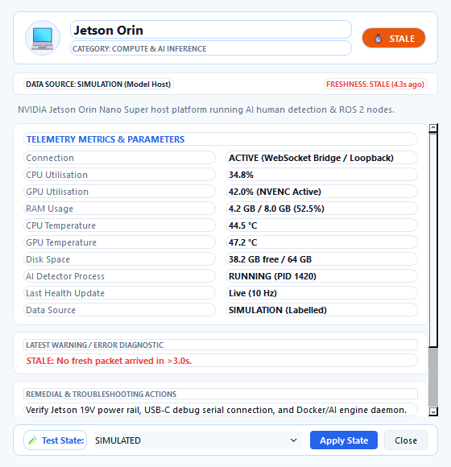

# 🛸 TEAM EDITH | NIDAR Rescue Ground Control Station (GCS)
**Autonomous GPS-Denied Indoor Search, Mapping & Survivor Localization Console**  
*NIDAR AirMouse Challenge — Track 1 (PS2)*  
*Main Maintainer:* [Shanmugapriyan R (Shan)](https://github.com/Shanmugapriyan25-R)

[](tests/)
[](requirements.txt)
[](edith_gcs_qt.py)
[](ros2_gcs_bridge.py)
[](SECURITY.md)

---

## 📌 Executive Summary

The **TEAM EDITH NIDAR Rescue Ground Control Station (GCS)** is an aerospace-grade, high-performance tactical monitoring, SLAM mapping, and robotic command console. Engineered specifically for micro-UAVs operating inside **GPS-denied, obstacle-dense indoor disaster corridors**, it delivers real-time situational awareness, autonomous mission management, and multi-target survivor localization.

Built with a modular data architecture, the GCS seamlessly switches between **Offline Simulation Mode**, **Atomic JSON Flight Feeds**, and live **ROS 2 Humble / MAVLink WebSocket Telemetry Bridges**.

---

## 📸 System Showcase & Workspaces

### 1. Tactical Mission Console (16:9 1080p Operator View)
Unified reconnaissance overview featuring simulated FLIR thermal imagery, real-time 2D SLAM metric arena mapping, 6-target survivor roster, and vital telemetry metrics.


### 2. Tactical 2D SLAM & Arena Metric Grid
Dedicated full-screen SLAM view with layer controls (LiDAR point cloud, trajectory ribbons, metric A–O/1–15 grid, search zones, and target coordinates table).


### 3. Survivor Search & Roster Workspace
Dedicated casualty search workspace featuring real-time status filtering (ALL, LOCALIZED, SEARCHING, LOST), confidence sorting, and bidirectional map synchronization.


### 4. Interactive Subsystem Hardware Diagnostics Dialog
Live hardware inspection modal tracking 11 onboard subsystems across 7 standardized health states with telemetry metric cards and simulation error injection.


---

## 🌟 Core Architectural Capabilities

### 🗺️ Tactical 2D SLAM & Metric Coordinate Grid
- **Metric Arena Coordinates:** 15m × 15m arena divided into a high-visibility $1\,\text{m}$ grid labeled **A–O** (horizontal) and **1–15** (vertical).
- **Point Cloud & Trajectory Visualization:** Dynamic drone position rendering with trail ribbons, simulated LiDAR scan cone ($10\,\text{Hz}$, $12\,\text{m}$ range), and obstacle proximity markers.
- **Layer Visibility Controls:** Operators can toggle point cloud density, breadcrumb trails, coordinate grids, search sector outlines, and casualty icons independently.

### 👥 Survivor Localization & Multi-Target Tracking
- **Exact 6-Target Capacity (S01–S06):** Designed specifically for the AirMouse challenge survivor localization specification.
- **Comprehensive Metadata:** Tracks discrete grid location (e.g., `Grid [D-5]`), metric offsets ($X: 3.2\,\text{m}, Y: 7.4\,\text{m}$), confidence scores ($0.00 - 1.00$), detection timestamps, and movement classification (`STATIC` vs `MOVING`).
- **Bidirectional Navigation Synchronization:** Selecting a survivor target automatically centers and highlights the marker on the tactical map and locks the camera tracking HUD.

### 🩺 Hardware Health & Diagnostic Model (`health_model.py`)
Monitors 11 mission-critical onboard subsystems:
1. **Jetson Orin** (Edge AI Inference Host)
2. **Jetson Gimbal / Mount** (2-Axis Brushless Mount)
3. **Camera & Gimbal** (Sony Sensor & Payload Gimbal)
4. **RadioLink CrossFlight** (ArduPilot Flight Controller)
5. **Power & Battery** (4S LiPo Monitoring Unit)
6. **RPLIDAR C1** (360° DTOF Laser Scanner)
7. **IMU / GPS Localisation** (9-DOF EKF3 Navigation Filter)
8. **ROS 2 Bridge** (WebSocket Micro-ROS Interface)
9. **MAVLink** (MAVLink v2 Protocol Stream)
10. **AI Detection Pipeline** (YOLOv8-Rescue TensorRT Engine)
11. **SLAM & Mapping** (Cartographer 2D LIDAR Stack)

Each subsystem reports one of 7 standardized states:
- `OK` (Optimal Operation)
- `WARN` (Degraded Performance / High Temperature)
- `FAIL` (Critical Subsystem Error)
- `STALE` (Heartbeat Timeout $> 2.0\,\text{s}$)
- `REDUCED_ACCURACY` (Sensor Drift / Incomplete Fix)
- `NOT_CONFIGURED` (Optional Payload Not Present)
- `SIMULATED` (Synthetic Test Stream)

### 🔌 Pluggable Telemetry Engine (`gcs_data_plugins.py`)
- **Simulation Mode:** Deterministic flight path simulation, target discoveries, dynamic battery consumption, and obstacle generation for dry runs.
- **Atomic JSON Feed (`data/mission.json`):** Hot-reloading normalized JSON state supporting atomic file swaps from external companion computers.
- **HTTP JSON Stream:** Polled REST endpoint for network-tethered UAV operations.
- **ROS 2 WebSocket Bridge (`ros2_gcs_bridge.py`):** High-speed asynchronous WebSocket server bridging ROS 2 Humble topics (`/odom`, `/scan`, `/map`, `/drone/battery`, `/survivors/detections`, `/diagnostics`) at $10-20\,\text{Hz}$.

---

## 🛡️ Security & Operator Safety

This repository strictly complies with the safety guidelines documented in [SECURITY.md](SECURITY.md):
- **Command Boundary Clamping:** Waypoint stages, velocity commands, and altitude targets are strictly verified against physical arena envelopes.
- **Automatic Heartbeat Fail-Safe:** If ground link telemetry drops for $> 2.0\,\text{s}$, the system flags a stale link alert and engages automated hover hold or Return-to-Launch (RTL).
- **Physical Emergency Abort:** Single-click operator abort immediately cuts autonomous trajectory commands and initiates controlled emergency touchdown.
- **Sanitized Reconnaissance Storage:** Runtime snapshots and video recordings are stored locally under `output/snapshots/` and `output/recordings/` and are excluded from Git tracking via `.gitignore`.
- **Zero Embedded Credentials:** No private keys, API secrets, or passwords exist in this codebase.

---

## 📁 Repository Structure

```
Shanmugapriyan25-R/NIDAR-Rescue-GCS/
├── edith_gcs_qt.py           # Primary PyQt6 tactical GCS operator console
├── gcs_workspaces.py         # Dedicated navigation workspaces (Map, Survivors, Cam, Telemetry)
├── subsystem_diagnostics.py  # Interactive hardware diagnostics inspection dialog
├── health_model.py           # Subsystem health state manager & diagnostic models
├── gcs_data_plugins.py       # Pluggable telemetry engine (Sim, JSON, HTTP)
├── gcs_client.py             # Asynchronous WebSocket bridge client & command dispatcher
├── ros2_gcs_bridge.py        # ROS 2 Humble WebSocket telemetry bridge
├── edith_gcs.py              # Lightweight fallback desktop implementation
├── data/
│   └── mission.json          # Normalized mission telemetry & target feed
├── assets/                   # High-contrast UI icons, logos, and target thumbnails
├── output/                   # Verified screenshots, UI plan, and documentation assets
│   ├── snapshots/            # Local directory for operator snapshots (.gitkeep)
│   └── recordings/           # Local directory for video frame dumps (.gitkeep)
├── tests/                    # Automated pytest test suite (48 comprehensive tests)
│   ├── test_autonomous_mission.py
│   ├── test_bridge_socket.py
│   ├── test_data_plugins.py
│   ├── test_gcs_client.py
│   ├── test_gui_controls.py
│   ├── test_hardware_health.py
│   ├── test_imports_startup.py
│   └── test_navigation_workspaces.py
├── DATA_PLUGINS.md           # Data engine schema & ROS 2 bridging specification
├── SECURITY.md               # Tactical safety architecture & vulnerability policy
├── requirements.txt          # Python dependency specifications
├── run_gcs.bat               # Windows one-click launcher
└── run_gcs.sh                # Linux Ubuntu launcher
```

---

## 🚀 Quick Start Guide

### 🪟 Windows Setup (PowerShell / Command Prompt)
1. Clone the repository:
   ```bash
   git clone https://github.com/Shanmugapriyan25-R/NIDAR-Rescue-GCS.git
   cd NIDAR-Rescue-GCS
   ```
2. Create and activate a virtual environment:
   ```powershell
   python -m venv .venv
   .venv\Scripts\Activate.ps1
   ```
3. Install dependencies:
   ```powershell
   pip install -r requirements.txt
   ```
4. Launch the Tactical Operator Console:
   ```powershell
   python edith_gcs_qt.py
   # Or simply double-click run_gcs.bat
   ```

### 🐧 Linux (Ubuntu 22.04 LTS / Jammy)
1. Install system prerequisites and Python packages:
   ```bash
   sudo apt update
   sudo apt install -y python3-pyqt6 python3-pip
   pip3 install -r requirements.txt
   ```
2. Launch the GCS:
   ```bash
   chmod +x run_gcs.sh
   ./run_gcs.sh
   ```

---

## 🧪 Automated Testing & Verification

The codebase includes **48 automated unit and integration tests** validating GUI widgets, navigation workspaces, telemetry plugins, WebSocket command roundtrips, and hardware health state machines.

To run the full test suite:
```powershell
pytest -v
```

Expected output:
```text
============================= 48 passed in 8.85s ==============================
```

---

## 👥 Authors & Core Team

- **Shanmugapriyan R (Shan)** — *GCS Frontend & Architecture Lead* · [GitHub](https://github.com/Shanmugapriyan25-R)
- **Sheldon** — *Mission Architecture & Autonomy Systems*
- **Mukil** — *System Integration Lead*
- **TEAM EDITH** — *NIDAR AirMouse Challenge 2026*

---

## 📄 License

This project is developed for the NIDAR AirMouse Challenge. Distributed under the **MIT License**. See `LICENSE` for details.
